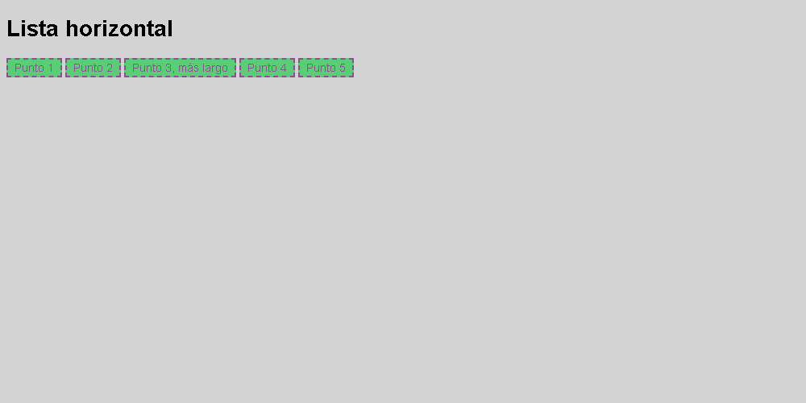

# Lista horizontal

Coloca los cinco elementos en una fila mediante Flexbox, siguiendo la referencia.

El HTML y los colores están preparados. Completa **style.css**.

## Diseño esperado

## Colores de referencia

| Elemento | Color |
| --- | --- |
| Fondo de página | `#d3d3d3` |
| Fondo de elementos | `#5ace77` |
| Texto y borde | `#954a95` |
