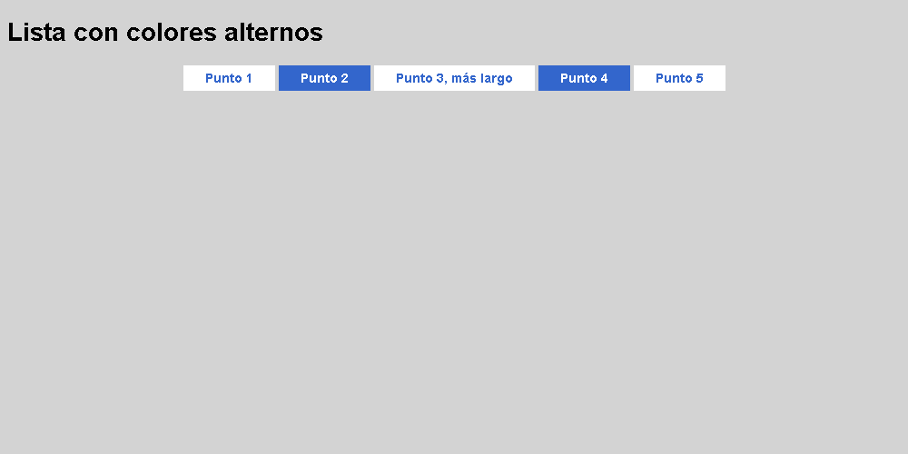

# Lista con colores alternos

Coloca los cinco elementos en una fila centrada mediante Flexbox. Conserva los colores alternos.

El HTML y los colores están preparados. Completa **style.css**.

## Diseño esperado

## Colores de referencia

| Elemento | Color |
| --- | --- |
| Fondo de página | `#d3d3d3` |
| Azul | `#3366cc` |
| Blanco | `#ffffff` |
