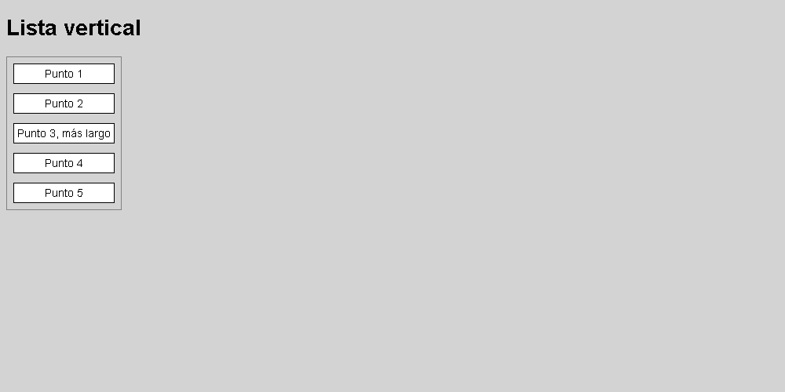

# Lista vertical

Coloca los cinco elementos en una columna mediante Flexbox, usando `flex-direction: column`. El borde exterior debe ajustarse al conjunto.

El HTML y los colores están preparados. Completa **style.css**.

## Diseño esperado

## Colores de referencia

| Elemento | Color |
| --- | --- |
| Fondo de página | `#d3d3d3` |
| Borde exterior | `#808080` |
| Fondo de elementos | `#ffffff` |
| Texto y borde interior | `#000000` |
