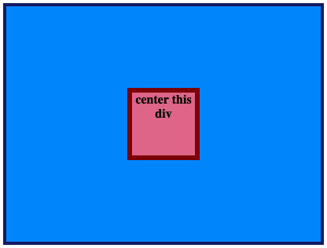

# Centra este div

Es un ejercicio sencillo, pero es algo que querrás hacer constantemente. Mejor practicarlo desde el principio.

Solo tienes que centrar el div rojo dentro del contenedor azul.

## Diseño esperado

### Autoevaluación

- ¿El div rojo está centrado?
- ¿Has usado únicamente Flexbox para centrarlo?
