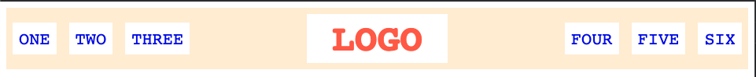
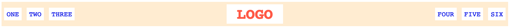

# Una cabecera básica

Utiliza Flexbox para crear este tipo de cabecera tan habitual. Su ventaja es que todo debería ser flexible. Observa las dos capturas para ver cómo debe adaptarse al ancho de la ventana. Además de las reglas de Flexbox, tendrás que ajustar márgenes y rellenos. Pista: las listas ul tienen márgenes y rellenos predeterminados que deberás revisar.

## Diseño esperado

Ventana estrecha:

Ventana amplia:

### Autoevaluación

- Hay espacio entre los elementos y los bordes de la cabecera.
- El logotipo está centrado vertical y horizontalmente.
- Los elementos de las listas están en horizontal y centrados verticalmente dentro de la cabecera.
- Los enlaces de la izquierda y la derecha permanecen en sus respectivos extremos al cambiar el tamaño de la ventana.
- La solución no utiliza float, inline-block ni posicionamiento absoluto.

Nota: en este ejercicio no es necesario reproducir exactamente la tipografía.
