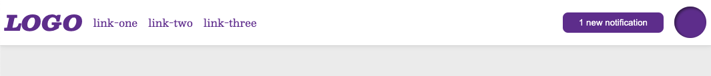

# Otro estilo de cabecera habitual

Empezamos a incluir algo de CSS que quizá todavía no conozcas. No te preocupes por ahora: sirve para mejorar la apariencia y no interfiere con tu tarea.

En este ejercicio probablemente tendrás que modificar un poco el HTML. Con Flexbox suele ser necesario añadir contenedores para colocar los elementos donde queremos. En este caso puede ayudarte separar los elementos que van a la izquierda de los que van a la derecha.

Como en el ejercicio 05-flex-header, tendrás contenedores flex dentro de otros contenedores flex.

## Diseño esperado

El espacio central debe ser flexible, con los elementos situados a izquierda y derecha.

### Autoevaluación

- Todos los elementos están centrados verticalmente dentro de la cabecera.
- Hay espacio entre los elementos y el borde de la cabecera.
- Los elementos están colocados en horizontal, como en la referencia.
- Hay una separación uniforme entre los elementos de cada lado.
- Toda la distribución utiliza Flexbox.
