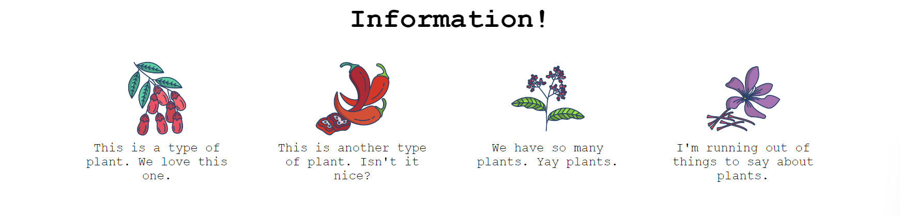

# Una sección muy habitual en las webs

El objetivo de este ejercicio es reproducir una sección que aparece en muchas páginas informativas.

También tendrás que modificar un poco el HTML. No vamos a ponértelo todo demasiado fácil: añade contenedores alrededor de los elementos para poder distribuirlos con Flexbox. ¡Suerte!

## Diseño esperado

### Autoevaluación

- El conjunto está centrado horizontalmente en la página.
- El título está centrado.
- Hay separación entre el título y los elementos.
- La separación entre los elementos es uniforme.
- Los elementos están colocados en horizontal.
- Cada elemento tiene un ancho limitado y su texto ocupa varias líneas.
- El texto de cada elemento está centrado.
