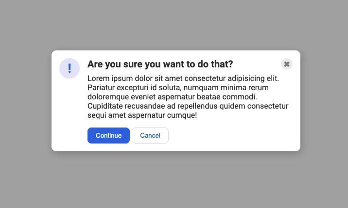

# Una ventana modal habitual

Este es otro patrón muy común en la web. La solución es sencilla, aunque quizá no resulte evidente al principio. Tendrás que modificar un poco el HTML para colocar cada elemento en su sitio.

### Una pista

Según cómo lo plantees, puede ayudarte revisar flex-shrink para evitar que un elemento se comprima demasiado. Presta atención a la estructura del HTML: considera añadir un contenedor que agrupe el título, el botón de cierre, el texto y los botones de cancelar y continuar. También puede ayudarte agrupar el botón de cierre con el título.

## Diseño esperado

### Autoevaluación

- El icono azul está a la izquierda.
- El espacio entre el icono y el borde de la tarjeta es igual al espacio entre el icono y el texto.
- La ventana tiene relleno interior.
- El título, el texto y los botones están alineados entre sí.
- El título está en negrita y es algo mayor que el texto.
- El botón de cierre está alineado verticalmente con el título, en la esquina superior derecha.
