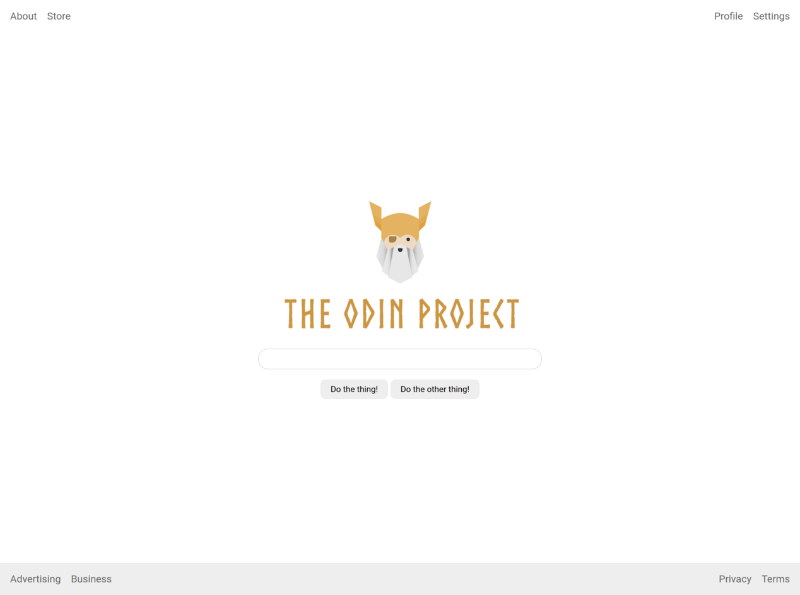

# ¡Una página completa!

Flexbox sirve tanto para distribuir páginas completas como para los componentes pequeños que hemos trabajado hasta ahora. En este ejercicio tendrás algo más de trabajo y puede que encuentres cosas nuevas. Puedes buscar en Internet lo que no tengas claro.

### Pistas

- Puede ayudarte buscar cómo quitar las viñetas de una lista con CSS. En los ejercicios anteriores ya estaban quitadas; aquí tendrás que hacerlo tú.
- Investiga cómo dar estilo a los enlaces para eliminar el subrayado.
- El body ya tiene height: 100vh, por lo que ocupa la altura de la ventana. Para mantener el pie abajo tendrás que usar Flexbox y cambiar la dirección a columna.

## Diseño esperado

### Autoevaluación

- La cabecera está arriba y el pie abajo, y mantienen su posición al cambiar el tamaño de la ventana.
- La cabecera y el pie tienen relleno interior.
- Sus enlaces están repartidos entre ambos extremos.
- Hay separación entre los enlaces.
- El fondo del pie es gris claro (#eeeeee).
- El logotipo, el campo de texto y los botones están centrados en la pantalla.
- Los botones tienen relleno interior.
- Hay separación entre el logotipo, el campo de texto y los botones.
