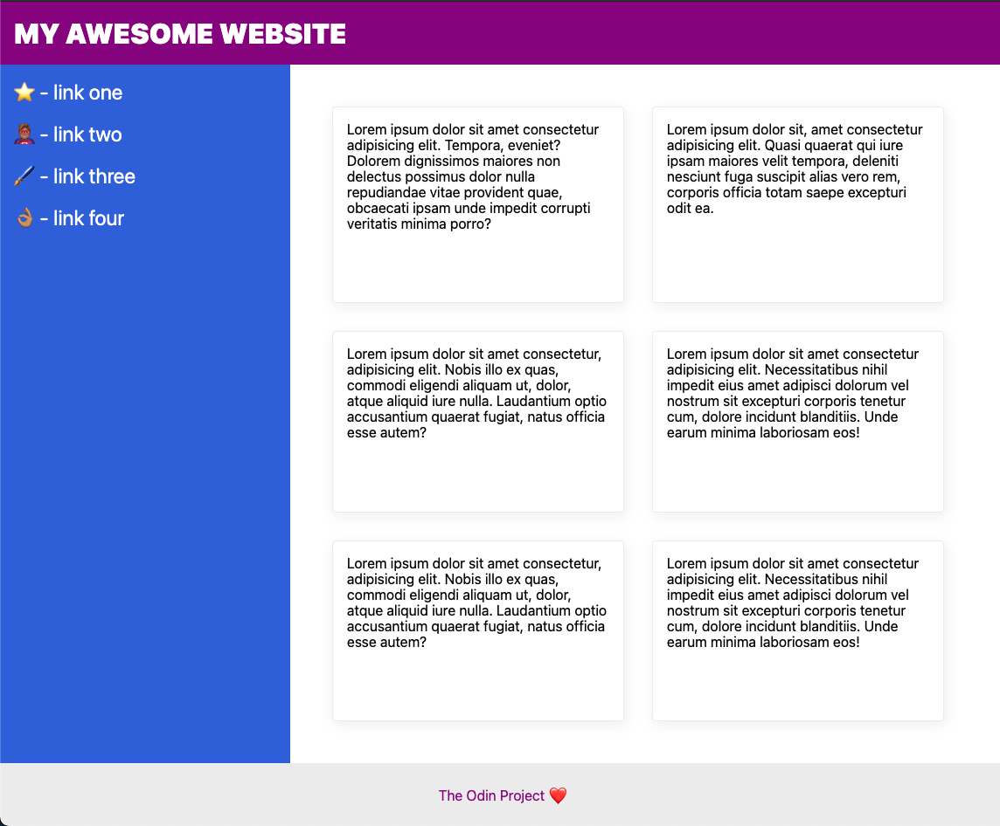
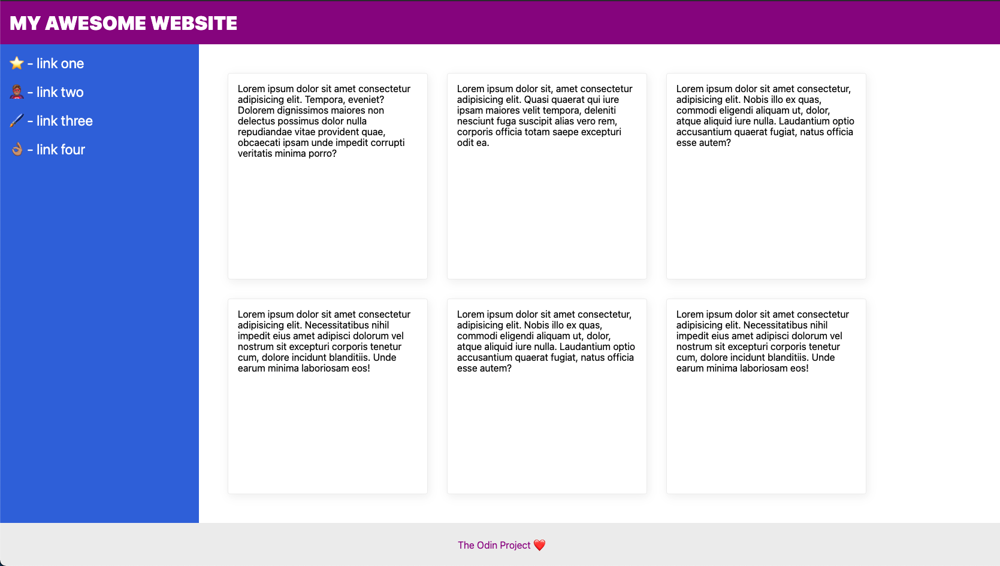

# El «Santo Grial» de las distribuciones

En este último ejercicio reproducirás una estructura de página tan habitual que suele llamarse «Holy Grail» o «Santo Grial». Con Flexbox resulta bastante sencilla de conseguir.

Como en el ejercicio anterior, tendrás algo más de trabajo que completar.

### Pistas

- Tendrás que cambiar flex-direction para desplazar el pie hacia abajo.
- Añade contenedores div para alinear los elementos.
- flex-wrap te ayudará a distribuir las tarjetas.
- Define cuánto espacio deben ocupar las tarjetas para que flex-wrap funcione como esperas.

## Diseño esperado

En una ventana más estrecha:

En una ventana amplia:

El número de tarjetas por fila depende del ancho de la ventana. No te preocupes por conseguir exactamente dos filas de tres tarjetas o tres filas de dos.

Nota: si tu sistema no dispone de una fuente con emojis, estos pueden aparecer como uno o varios símbolos de texto. No afecta al ejercicio.

### Autoevaluación

- El texto de la cabecera tiene un tamaño de 32 px y un peso de 900.
- Está centrado verticalmente y separado del borde.
- El pie queda al fondo de la pantalla. Puede quedar por debajo de la parte visible si el contenido necesita más altura.
- El texto del pie está centrado horizontal y verticalmente.
- La barra lateral y las tarjetas ocupan todo el espacio disponible sobre el pie.
- La barra lateral tiene un ancho de 300 px y no se encoge.
- Los enlaces laterales tienen un tamaño de 24 px, son blancos y no están subrayados.
- La barra lateral y la zona de tarjetas tienen relleno interior.
- Las tarjetas se colocan en horizontal y pasan a nuevas filas cuando falta espacio.
